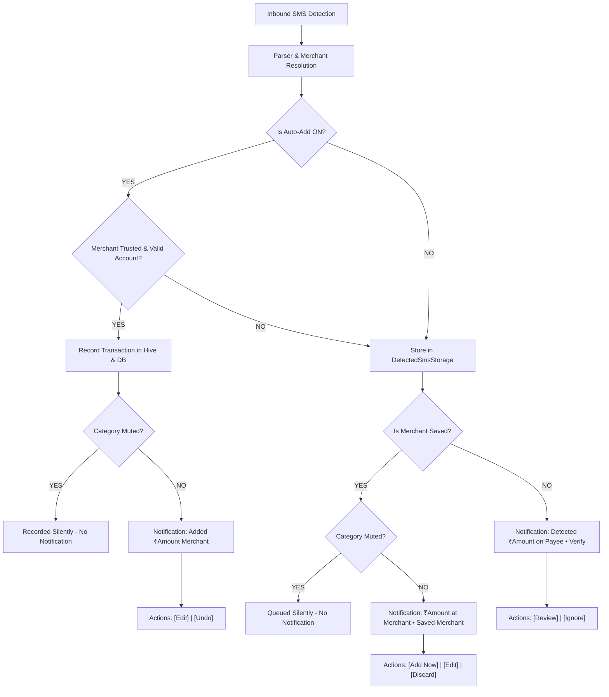

# SpentX Notification Architecture & Lifecycle Engine

This document provides a comprehensive technical reference for the notification lifecycle, state machine, action handlers, category filtering algorithms, and UI flow routing in SpentX.

---

## 1. Root Cause Analysis of Previous Notification Gaps

| Symptom / Issue | Root Cause in Code | Implemented Fix |
| :--- | :--- | :--- |
| **Missing Merchant or Amount Context** | Collapsed BigTextStyle title was previously generic (`₹450 added • HDFC • Food`). Tapping without expanding hid the payee. | Title is enriched to lead prominently with merchant name and amount (`Added ₹450 Swiggy` / `₹450 at Swiggy • HDFC • Food & Dining`). |
| **No Interactive Quick Actions** | Notifications in `showAutoSaved` and `showPendingNotification` lacked action buttons (`actions: null`). Users were forced to open the app for every single review. | Added interactive `AndroidNotificationAction` buttons: `[Edit]`, `[Undo]`, `[Add Now]`, `[Discard]`, `[Review]`, `[Ignore]`. |
| **Saved Merchants Treated Like Unknown Payees when Auto-Add is OFF** | `_commitUnknownMerchantPending` invoked `showPendingNotification` without passing whether the merchant had saved rules or categories. | Added `isSavedMerchant` detection and `category` forwarding. Now presents specialized `[Add Now]`, `[Edit]`, and `[Discard]` actions. |
| **Extraneous / Clashing Popups on App Entry** | Tapping `Edit` on an auto-saved transaction navigated to `/transaction/:id` (read-only view) without activating edit mode, while pending verification was triggering queue auto-popups simultaneously. | Added `initialEdit` route parameter (`/transaction/:id?edit=true`) which instantly triggers `EditTransactionSheet`, while `PendingVerificationPresenter` isolates target transactions to suppress generic queue summaries. |
| **Lack of Category Muting Option** | `SmsNotificationService` only evaluated global `auto_detection` toggle without checking category preferences. | Implemented `muted_notification_categories` in Hive `settings` box and `isCategoryNotificationAllowed()`. Transactions in muted categories remain logged silently without push notifications. |

---

## 2. Notification State Machine



---

## 3. Detailed Notification Specifications

### A. Automatic Add is ON (`auto_add_notifications_enabled: true`)
* **Collapsed Tray View:**
  ```text
  💸 Added ₹450 Swiggy
  Debited from HDFC ••1234 • Food & Dining
  ```
* **Expanded View (BigTextStyle):**
  ```text
  ┌─────────────────────────────────────────────────────────────┐
  │ 💸 SpentX • Just now                                        │
  │ Added ₹450 Swiggy                                           │
  │ ₹450 added • HDFC • Food & Dining                           │
  │ Swiggy • Personal                                           │
  │                                                             │
  │ [Edit]                                              [Undo]  │
  └─────────────────────────────────────────────────────────────┘
  ```
* **Action Routing:**
  * **`[Edit]`** (`action_edit`): Opens app directly to `/transaction/:id?edit=true`, which automatically presents `EditTransactionSheet`. No unrelated popups show.
  * **`[Undo]`** (`action_undo`): Dispatches `SmsAutoSaveActions.undo(ref, txId)`, restores balances, marks dedupe key undone, cancels notification, and displays in-app feedback toast.

---

### B. Automatic Add is OFF: Saved / Recognized Merchant
* **Collapsed Tray View:**
  ```text
  ☕ ₹280 at Starbucks
  Saved merchant • Category: Coffee & Snacks
  ```
* **Expanded View:**
  ```text
  ┌─────────────────────────────────────────────────────────────┐
  │ ☕ SpentX • Detected Transaction                            │
  │ ₹280 at Starbucks                                           │
  │ Saved merchant • Category: Coffee & Snacks                  │
  │                                                             │
  │ [Add Now]                 [Edit]                  [Discard] │
  └─────────────────────────────────────────────────────────────┘
  ```
* **Action Routing:**
  * **`[Add Now]`** (`action_add_now`): Auto-commits the transaction in the background with saved category, purpose, and account. Dismisses notification without interrupting user.
  * **`[Edit]`** (`action_edit`): Opens app directly to `DetectionPopup` for this exact transaction.
  * **`[Discard]`** (`action_discard`): Drops the pending detection (`ignoreTransaction(txId)`) and cancels notification.

---

### C. Automatic Add is OFF: Unrecognized / New Merchant
* **Expanded View:**
  ```text
  ┌─────────────────────────────────────────────────────────────┐
  │ ❓ SpentX • New Spend Detected                              │
  │ Detected ₹650 on FreshMart                                  │
  │ Payee • HDFC                                                │
  │                                                             │
  │ [Review]                                           [Ignore] │
  └─────────────────────────────────────────────────────────────┘
  ```
* **Action Routing:**
  * **`[Review]`** (`action_review`): Opens app directly to `DetectionPopup` for this transaction.
  * **`[Ignore]`** (`action_ignore`): Ignores and removes item from pending queue.

---

### D. New Account Discovery
* **Layout:**
  ```text
  ┌─────────────────────────────────────────────────────────────┐
  │ 🏦 SpentX • New Account Discovered                           │
  │ New HDFC account ••4921 found                               │
  │ New account detected (Bank account) — Tap to verify         │
  │                                                             │
  │ [Add]                                             [Not Mine]│
  └─────────────────────────────────────────────────────────────┘
  ```
* **Action Routing:**
  * **`[Add]`** (`account_add`): Routes to `/verify-account?id=...` with bank name, account kind, and last-4 pre-filled.
  * **`[Not Mine]`** (`account_not_mine`): Dismisses suggestion and marks account identifier as ignored/blacklisted.

---

## 4. Category Notification Muting Architecture

Users can selectively disable notifications by category in **Settings ➔ Notifications ➔ Category Notification Filters**.

### Persistence Schema (Hive `settings` box):
* `muted_notification_categories`: `List<String>` containing normalized category names (e.g. `['shopping', 'entertainment']`).
* `auto_add_notifications_enabled`: `bool` (default: `true`).
* `pending_notifications_enabled`: `bool` (default: `true`).
* `new_account_notifications_enabled`: `bool` (default: `true`).

### Evaluation Flow (`SmsNotificationService.isCategoryNotificationAllowed`):
1. Receive incoming transaction category (e.g., `'Shopping'`).
2. Normalize string (`category.trim().toLowerCase()`).
3. Check against `muted_notification_categories`.
4. If matched: **Suppress banner notification**. Transaction is still logged to Hive / database seamlessly.

---

## 5. Master Idea Catalog: Comprehensive Notification Opportunities

1. **Transaction Lifecycle**
   * *Self-Transfer & Wallet Merges*: Consolidates debit & credit SMS pair into one transfer notification (`HDFC ➔ Paytm Wallet`).
   * *Refunds & Cashbacks*: Identifies credited refunds and links to original transactions (`₹350 Refund from Swiggy`).
   * *Reversals / Failed Payments*: Alerts when a transaction was cancelled or declined, preventing phantom expense logging.
2. **Trip & Outing Smart Mode**
   * *Trip Auto-Attach*: Shows `🏖 Added to Goa Trip • ₹450 at Fisherman's Wharf`.
   * *Trip Budget Milestone*: Alerts when outing expenditure exceeds 75% of trip budget.
3. **Budget & Spend Velocity**
   * *80% / 100% Category Thresholds*: Warnings when dining or shopping budgets are almost depleted.
   * *Daily Spike Alert*: Alerts on single expenses exceeding 3x daily average.
4. **Credit Cards & Bills**
   * *Bill Due Date Reminders*: 3-day and 1-day reminders before credit card due date.
   * *High Utilization Flag*: Warning when card balance exceeds 30% of total credit limit.
   * *Upcoming Subscription Renewals*: 24h heads-up before recurring auto-debits (Netflix, Spotify).
5. **Periodic Digests**
   * *Weekly Money Pulse*: Sunday evening celebration of financial health and top spend categories.
   * *Monthly Wrap-Up*: High-level breakdown of savings and expenditure distribution on the 1st of each month.
